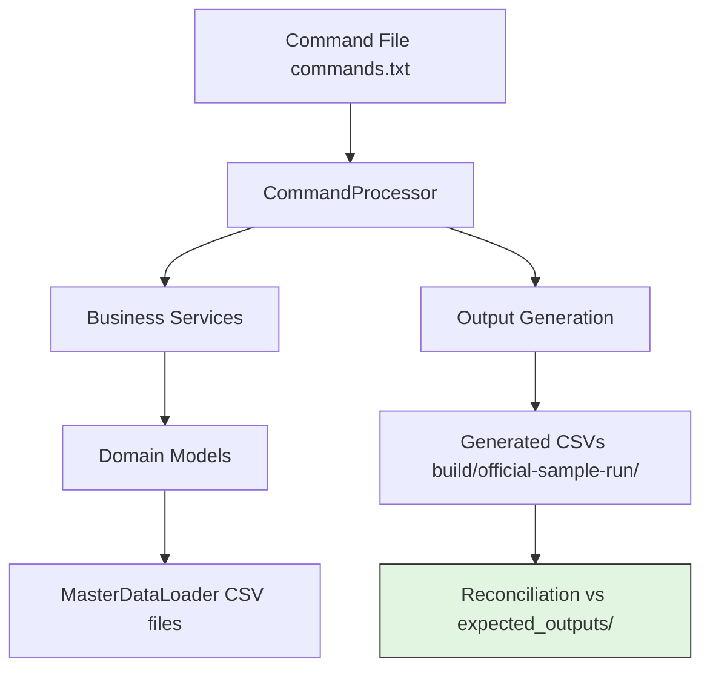
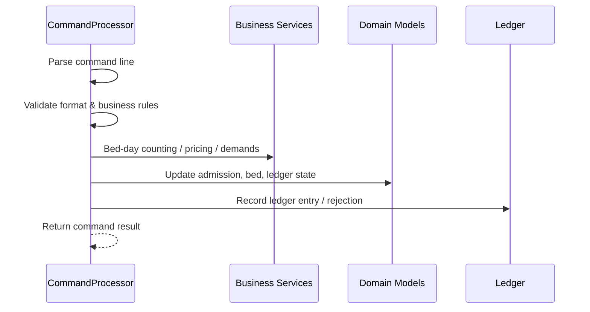

# Hospital Inpatient Billing and Bed Management Engine

**PS-064 | Team T008** — Capstone project, 10 SECONDS

A command-file-driven Python backend engine that simulates hospital inpatient operations: patient admission, bed allocation, category transfers, ICU movement, charge-event processing (doctor visits, procedures, OT, pharmacy, consumables, investigations), package management with conversion, deposit and top-up-demand lifecycle, discounts, GST calculation, interim billing, discharge settlement, and bed lifecycle management.

Processes a command text file (`commands.txt`) and generates financial ledgers, final bills, top-up demands, rejections, interim bills, and bed-occupancy snapshots in CSV format.

---

## Project Badges


---

## Navigation

- [Project Overview](#project-overview)
- [Problem Statement](#problem-statement)
- [Project Objectives](#project-objectives)
- [Key Capabilities](#key-capabilities)
- [Technology Stack](#technology-stack)
- [Architecture Overview](#architecture-overview)
- [Major Components](#major-components)
- [Supported Commands](#supported-commands)
- [Business-Rule Coverage](#business-rule-coverage)
- [Data Flow](#data-flow)
- [Repository Structure](#repository-structure)
- [Prerequisites](#prerequisites)
- [Installation](#installation)
- [How to Run the Application](#how-to-run-the-application)
- [How to Execute the Official Sample Dataset](#how-to-execute-the-official-sample-dataset)
- [How to Run Tests](#how-to-run-tests)
- [How to Reconcile Generated Outputs](#how-to-reconcile-generated-outputs)
- [Expected Output Files](#expected-output-files)
- [Example Workflow](#example-workflow)
- [Technical Documentation](#technical-documentation)
- [Architecture and Rendered Diagrams](#architecture-and-rendered-diagrams)
- [Verification and Validation Evidence](#verification-and-validation-evidence)
- [Demo Video](#demo-video)
- [Viva and Evaluation Resources](#viva-and-evaluation-resources)
- [Team Responsibilities](#team-responsibilities)
- [Known Limitations](#known-limitations)
- [Future Improvements](#future-improvements)
- [License](#license)

---

## Project Overview

The PS-064 Hospital Inpatient Billing and Bed Management Engine is a command-file-driven backend system written in Python. It models hospital inpatient operations end to end:

- Patient registration and admission with deposit validation
- Bed allocation with category, gender, and upgrade-free rules
- Category transfers and ICU step-down movements
- Charge-event processing (bed, nursing, doctor, procedure, OT, pharmacy, consumable, investigation)
- Category-at-event pricing with category-specific multipliers
- Package enrollment, ICU conversion (>48h), and retroactive repricing
- Deposit calculation and top-up-demand lifecycle with procedure blocking
- Senior, employee-referral, and charity discounts
- GST calculation (5% on qualifying room charges strictly above ₹5,000/day)
- Interim billing (manual and automatic 7-day cycles) with event locking
- Final discharge settlement with rounding, balance due, and refund due
- Bed lifecycle including reservations and housekeeping

All monetary calculations use `Decimal` with `ROUND_HALF_UP`. The engine is deterministic: the same inputs produce the same outputs, and command order is preserved.

---

## Problem Statement

Hospital inpatient billing involves complex, interdependent business rules:

- Bed-day counting with different time anchors (noon 12:00 for general beds, 08:00 for ICU beds) and admission/discharge boundary conditions
- Bed allocation respecting category availability, gender restrictions, and upgrade-free fallback
- Category transfers with limits and ICU step-down requirements
- Category-at-event pricing (charges use the category occupied at event time, not the current category)
- Doctor-visit charging with daily limits per category and free repeat visits
- Package enrollment, coverage, exclusions, length-of-stay, and conversion with retroactive repricing
- Deposit calculation, top-up demands at the 80% threshold (strictly greater), procedure blocking, and emergency exceptions
- Discounts (senior 10% bed/nursing, employee 15% doctor, charity up to 50% with CEO reference)
- GST on qualifying room charges above ₹5,000/day
- Interim billing with locked-event corrections via signed adjustment lines
- Final discharge settlement with payment gate, balance due, refund due, and LAMA/DAMA handling
- Bed lifecycle including 6-hour reservations and housekeeping clearance

---

## Project Objectives

- Implement a complete command-file-driven billing engine in Python 3.10+
- Enforce all 12 business rules (BR-01 through BR-12) plus BR-07a and BR-07b
- Handle 8 edge cases (EC-01 through EC-08)
- Generate all required output files with exact official schemas
- Reconcile generated outputs against official expected outputs
- Provide comprehensive test coverage (75 unit and integration tests)
- Prepare for capstone viva and live code modification exercises

---

## Key Capabilities

| Capability | Status | Notes |
|------------|--------|-------|
| Command parsing and validation | PASS | All 16 command types parsed and validated |
| Patient admission and bed allocation | PASS | ADMIT with deposit validation and bed allocation |
| Category transfer and ICU step-down | PASS | TRANSFER with limits; STEP_DOWN for ICU exit |
| Bed-day counting | PASS | Noon/ICU anchors; discharge boundary rules |
| Charge-event processing | PASS | BED, NURSING, DOCTOR, PROCEDURE, OT, PHARMACY, CONSUMABLE, INVESTIGATION |
| Category-at-event pricing | PASS | Historical category used for multipliers |
| Package management and conversion | PASS | Coverage, exclusions, LOS, ICU >48h conversion, REPRICE lines |
| Deposits and top-up demands | PASS | 80% threshold, 48h deadline, procedure blocking, emergency exception |
| Discounts | PASS | Senior, employee-referral, charity |
| GST calculation | PASS | 5% on room charges strictly above ₹5,000/day |
| Interim billing and corrections | PASS | Manual and automatic 7-day cycles; ADJ adjustment lines |
| Final discharge settlement | PASS | Rounding, balance due, refund due, LAMA/DAMA |
| Bed lifecycle | PASS | Reservations, housekeeping, occupancy snapshots |
| Output generation | PASS | Ledgers, bills, demands, rejections, interim bills, occupancy |
| Test suite | PASS | 75 unit and integration tests, all passing |
| Official sample reconciliation | PASS | 42/42 files matched; 10,223/10,223 fields matched |

---

## Technology Stack

| Component | Technology | Version |
|-----------|-----------|---------|
| Language | Python | 3.10+ (tested on 3.14.5) |
| Testing | pytest | 9.2.0 |
| Data format | CSV | UTF-8 |
| Command format | Pipe-delimited text | `COMMAND\|timestamp\|args` |
| External dependencies | None | Python standard library only |

---

## Architecture Overview

The engine follows a layered architecture:

```
┌─────────────────────────────────────────────────────────────┐
│  Command Processing Layer (src/billing_engine/commands/)    │
│  - Parsing, validation, execution, output generation        │
├─────────────────────────────────────────────────────────────┤
│  Business Rule Services (src/billing_engine/services/)      │
│  - Bed-day counting, pricing, transfers, packages,          │
│    discounts, GST, demands, ledger                          │
├─────────────────────────────────────────────────────────────┤
│  Domain Models (src/billing_engine/models/)                 │
│  - Patient, Doctor, Bed, Admission, ChargeEvent,            │
│    LedgerEntry, Deposit, Demand, InterimBill, Rejection     │
├─────────────────────────────────────────────────────────────┤
│  Data Access Layer (src/billing_engine/loaders/)            │
│  - MasterDataLoader: CSV loading for categories, beds,      │
│    doctors, tariffs, packages, admissions                   │
└─────────────────────────────────────────────────────────────┘
```

Supporting modules:
- `src/billing_engine/billing/` — BillingCalculator
- `src/billing_engine/ledger/` — LedgerManager
- `src/billing_engine/outputs/` — OutputGenerator and output serializers
- `scripts/reconcile_outputs.py` — Output generation and reconciliation
- `scripts/run_reconciliation.py` — Entry point for official sample execution

### Design Principles

- **Command-file driven**: All input via `commands.txt` with `COMMAND\|timestamp\|args` format
- **Decimal arithmetic**: All monetary calculations use `Decimal` with `ROUND_HALF_UP`
- **Category-at-event pricing**: Charges use the category occupied at event time
- **Deterministic**: Same inputs produce same outputs; command order preserved
- **No silent failures**: All rejected commands recorded with rejection codes
- **In-memory storage**: No database; assignment specifies command-file-driven backend

---

## Major Components

| Module | Responsibility |
|--------|---------------|
| `commands/__init__.py` | CommandParser, CommandProcessor, all 16 command handlers, output generation |
| `services/__init__.py` | BedDayCounter, PricingService, TransferService, PackageService, DiscountService, GSTService, DemandService, LedgerService |
| `models/__init__.py` | Patient, Doctor, Bed, Admission, ChargeEvent, LedgerEntry, Deposit, Demand, InterimBill, Rejection, Category, Gender |
| `loaders/__init__.py` | MasterDataLoader — loads all 6 master CSV files |
| `billing/__init__.py` | BillingCalculator |
| `ledger/__init__.py` | LedgerManager |
| `outputs/__init__.py` | OutputGenerator — ledger, bill, demands, rejections, interim bills, occupancy |
| `scripts/reconcile_outputs.py` | Runs sample execution and reconciles vs expected outputs |
| `scripts/run_reconciliation.py` | Thin entry-point wrapper |

---

## Supported Commands

The engine processes 16 command types in strict file order:

| Command | Description |
|---------|-------------|
| ADMIT | Admit patient with deposit validation and bed allocation |
| RESERVE_BED | Reserve a bed of requested category |
| TRANSFER | Transfer patient between categories |
| STEP_DOWN | ICU step-down (required to exit ICU) |
| VISIT | Doctor visit charge |
| PROCEDURE | Procedure charge (subject to top-up blocking) |
| OT | Operating theatre charge |
| PHARMACY | Pharmacy charge (MRP-based) |
| CONSUMABLE | Consumable charge |
| INVESTIGATION | Investigation charge |
| DEPOSIT | Deposit payment |
| INTERIM_BILL | Manual interim bill |
| CORRECTION | Correct a charge event (ADJ line if locked) |
| CHARITY | Apply charity discount |
| DISCHARGE | Discharge patient and settle final bill |
| HOUSEKEEPING_CLEARED | Clear bed from housekeeping to available |

Command format: `COMMAND\|timestamp\|arg1\|arg2\|...`  
Example: `ADMIT\|2026-01-15 10:00:00\|ADM-0001\|15000.00\|CASH`

---

## Business-Rule Coverage

All 12 business rules plus BR-07a and BR-07b are implemented and verified against the official 42-file reconciliation:

| Rule | Description | Status |
|------|-------------|--------|
| BR-01 | Bed-day counting (noon/ICU anchors, discharge boundaries) | PASS |
| BR-02 | Bed allocation and UPGRADE-FREE 48h window | PASS |
| BR-03 | Category transfers and ICU step-down | PASS |
| BR-04 | Category-at-event tariff multipliers | PASS |
| BR-05 | Doctor visit charging and daily limits | PASS |
| BR-06 | Package management, coverage, conversion, repricing | PASS |
| BR-07 | Deposits and top-up demand lifecycle | PASS |
| BR-07a | Average daily charge calculation and rounding | PASS |
| BR-07b | Procedure blocking and emergency exception | PASS |
| BR-08 | Senior, employee-referral, charity discounts | PASS |
| BR-09 | Interim billing and locked-event corrections | PASS |
| BR-10 | Final discharge settlement, payment gate, refunds | PASS |
| BR-11 | GST calculation (5% > ₹5,000/day, BED only) | PASS |
| BR-12 | Bed lifecycle, reservations, housekeeping | PASS |

Edge cases EC-01 through EC-08 are also covered (noon admission, 14:00 discharge, 23h59m stay, upgrade-free boundary, package ICU conversion, 80% threshold, GST ₹5,000 boundary, locked-event correction).

---

## Data Flow

```
Master Data (CSV files)
        ↓
Command File (commands.txt) — 837 commands, strict order
        ↓
CommandProcessor (parse → validate → dispatch → execute)
        ↓
Business Services (bed-day counting, pricing, packages, discounts, GST, demands)
        ↓
Domain Models (Admission, Bed, LedgerEntry, Demand, etc.)
        ↓
Output Generation (ledgers, bills, demands, rejections, interim bills, occupancy)
        ↓
Reconciliation vs expected_outputs/ (42 files, field-by-field)
```

---

## Repository Structure

```
T008-PS-064/
├── README.md
├── .gitignore
├── scripts/
│   ├── reconcile_outputs.py   # Output generation + reconciliation
│   └── run_reconciliation.py  # Entry point for official sample run
├── src/
│   └── billing_engine/
│       ├── __init__.py        # Package exports
│       ├── commands/          # Command processing + handlers + output
│       ├── models/            # Domain models
│       ├── loaders/           # Master data CSV loading
│       ├── services/          # Business rule services
│       ├── billing/           # Billing calculations
│       ├── ledger/            # Ledger management
│       └── outputs/           # Output serialization
├── tests/
│   ├── conftest.py            # Shared fixtures
│   ├── unit/                  # Unit tests (bed-day, allocation, transfers, packages)
│   └── integration/           # Integration tests (sample workflow)
├── data/
│   └── official/
│       └── T008-PS-064-sample-data/
│           ├── admissions.csv
│           ├── beds.csv
│           ├── categories.csv
│           ├── commands.txt
│           ├── doctors.csv
│           ├── packages.csv
│           ├── tariff.csv
│           ├── README.md
│           └── expected_outputs/   # 42 official expected output files
├── docs/
│   ├── week-0/                # Week 0 baseline
│   ├── week-1/                # Week 1 design
│   ├── week-3/                # Week 3 implementation
│   ├── week-4/                # Week 4 final submission materials
│   │   ├── defect-correction/ # Phase 0–6 defect correction reports
│   │   ├── diagrams/          # 8 Mermaid diagrams + rendered HTML
│   │   └── final-submission/  # This submission's documentation
│   ├── final-audit/           # Prompt 1 audit (phases 0–13)
│   └── progress/              # Evidence index and progress checklist
└── build/                     # Generated outputs (gitignored)
```

---

## Prerequisites

- Python 3.10 or higher (tested on Python 3.14.5)
- No external Python packages required — standard library only
- `pytest` for running tests (installed in the project environment, version 9.2.0)

---

## Installation

No `pip install` is required. The project uses only the Python standard library.

```powershell
# Clone the repository
git clone https://github.com/ASR729/T008-PS-064.git
cd T008-PS-064

# Verify Python version
python --version

# (Optional) Create and activate a virtual environment
py -3.11 -m venv .venv
.\.venv\Scripts\Activate.ps1

# Verify the project imports correctly
python -c "from src.billing_engine import CommandProcessor, MasterDataLoader; print('import OK')"
```

---

## How to Run the Application

Process the official command file and generate all outputs:

```powershell
# From the project root
python scripts/run_reconciliation.py
```

This:
1. Loads all master data from `data/official/T008-PS-064-sample-data/`
2. Processes all 837 commands from `commands.txt`
3. Generates output files in `build/official-sample-run/`
4. Reconciles generated outputs against `expected_outputs/`
5. Prints a reconciliation report (files matched, fields matched)

Outputs are written to a dedicated `build/official-sample-run/` directory — never inside `expected_outputs/`.

---

## How to Execute the Official Sample Dataset

The official sample data contains 837 commands across 40 admissions (18 visible with expected outputs).

```powershell
# Run the full sample execution and reconciliation
python scripts/run_reconciliation.py
```

Expected console output:

```
=== RECONCILIATION REPORT ===
Files compared: 42
Matching: 42
Mismatching: 0
Missing: []
Extra: []
Total fields: 10223
Matching fields: 10223
Mismatching fields: 0
```

To run from a clean output directory (reproducibility check), the reconciliation script can be pointed at any fresh output directory.

---

## How to Run Tests

```powershell
# Run all tests
python -m pytest -q

# Run with verbose output
python -m pytest tests/ -v

# Run unit tests only
python -m pytest tests/unit/ -v

# Run integration tests only
python -m pytest tests/integration/ -v
```

Expected result: `75 passed` (63 unit + 12 integration), 0 failed, 0 skipped.

---

## How to Reconcile Generated Outputs

The reconciliation is performed by `scripts/reconcile_outputs.py`:

```powershell
# From the project root
python scripts/run_reconciliation.py
```

The comparator:
- Pairs generated and expected files by exact filename
- Compares headers, row counts, and field-level values
- Ignores only `description` (ledgers) and `detail` (rejections) per the output contract
- Reports missing and extra files
- Does not weaken matching

---

## Expected Output Files

| Category | Count | Description |
|----------|-------|-------------|
| Patient ledgers | 18 | `ledger_ADM-XXXX.csv` — one per visible admission |
| Final bills | 18 | `bill_ADM-XXXX.csv` — one per discharged admission |
| Top-up demands | 1 | `demands.csv` |
| Rejections | 1 | `rejections.csv` |
| Interim bills | 1 | `interim_bills.csv` |
| Bed occupancy snapshots | 3 | `bed_occupancy_YYYYMMDD_HHMM.csv` |
| **Total** | **42** | |

Outputs are written to `build/official-sample-run/` and reconciled against `data/official/T008-PS-064-sample-data/expected_outputs/`.

---

## Example Workflow

```powershell
# 1. Load master data and inspect counts
python -c "
from src.billing_engine.loaders import MasterDataLoader
loader = MasterDataLoader()
loader.load_all()
print(f'Categories: {len(loader.categories)}')
print(f'Beds: {len(loader.beds)}')
print(f'Doctors: {len(loader.doctors)}')
print(f'Tariffs: {len(loader.tariffs)}')
print(f'Packages: {len(loader.packages)}')
print(f'Admissions: {len(loader.admissions)}')
"

# 2. Process an ADMIT command
python -c "
from src.billing_engine.commands import CommandProcessor
from src.billing_engine.loaders import MasterDataLoader
loader = MasterDataLoader(); loader.load_all()
processor = CommandProcessor(loader)
cmd = 'ADMIT\|2026-01-15 10:00:00\|ADM-0001\|15000.00\|CASH'
parsed = processor.parse_command(cmd, 1)
result = processor.process_command(parsed)
print(f'ADMIT success={result.success}, error={result.error_code}')
"

# 3. Run the full test suite
python -m pytest -q

# 4. Run the official sample and reconcile
python scripts/run_reconciliation.py
```

---

## Technical Documentation

| Document | Path |
|----------|------|
| Week 0 baseline and requirements | `docs/week-0/` |
| Week 1 design package | `docs/week-1/` |
| Week 3 implementation traceability | `docs/week-3/` |
| Week 4 defect-correction reports | `docs/week-4/defect-correction/` |
| Week 4 final design document | `docs/week-4/final-submission/final-design-document.md` |
| Week 4 final decision log | `docs/week-4/final-submission/final-decision-log.md` |
| BR/EC traceability matrix | `docs/week-4/final-submission/business-rule-edge-case-traceability.md` |
| Test and reconciliation report | `docs/week-4/final-submission/final-test-and-reconciliation-report.md` |
| Financial integrity report | `docs/week-4/final-submission/financial-integrity-report.md` |
| Occupancy verification report | `docs/week-4/final-submission/occupancy-verification-report.md` |
| Final execution report | `docs/week-4/final-submission/FINAL-EXECUTION-REPORT.md` |
| Evidence index | `docs/progress/evidence-index.md` |
| Weekly progress checklist | `docs/progress/weekly-progress-checklist.md` |
| Full audit (Prompt 1) | `docs/final-audit/` |

---

## Architecture and Rendered Diagrams

Eight diagrams document the system (Mermaid sources under `docs/week-4/diagrams/`, rendered HTML at `docs/week-4/diagrams/diagrams.html`):

1. Domain/class diagram — `docs/week-4/diagrams/domain_class.mmd`
2. Patient/admission lifecycle — `docs/week-4/diagrams/patient_admission_lifecycle.mmd`
3. Bed lifecycle — `docs/week-4/diagrams/bed_lifecycle.mmd`
4. Command-processing workflow — `docs/week-4/diagrams/command_processing.mmd`
5. Billing and ledger flow — `docs/week-4/diagrams/billing_ledger_flow.mmd`
6. Package conversion and repricing flow — `docs/week-4/diagrams/package_conversion.mmd`
7. Deposit/top-up demand and procedure-blocking flow — `docs/week-4/diagrams/demand_block_flow.mmd`
8. Final discharge and settlement flow — `docs/week-4/diagrams/discharge_settlement.mmd`

High-level architecture (Mermaid):



Command-processing sequence:



---

## Verification and Validation Evidence

| Evidence | Result |
|----------|--------|
| Unit + integration tests | 75 passed, 0 failed |
| Official sample files | 42 expected, 42 generated, 42 matched |
| Output fields | 10,223 compared, 10,223 matched, 0 mismatches |
| Missing / extra files | 0 missing, 0 extra |
| Clean second execution | 42/42 matched (reproducible) |
| Official inputs unmodified | `git diff -- data/official/` empty |
| Business rules | BR-01 through BR-12, BR-07a, BR-07b — all PASS |
| Edge cases | EC-01 through EC-08 — all PASS |
| Git state | HEAD `4bcca54`; origin/master `4bcca54`; SYNCED |

Full audit evidence is documented under `docs/final-audit/` (Prompt 1 phases 0–13).

---

## Demo Video

A five-minute demonstration script and recording checklist are prepared:

- Script: `docs/week-4/demo-script.md`
- Recording checklist: `docs/week-4/demo-recording-checklist.md`

**Status:** The demonstration video has not been recorded in this environment (no video-recording capability available). The team must record the video externally (e.g., OBS Studio, Loom) following the script and checklist, then add the video link to the submission email.

Suggested location: `docs/week-4/final-submission/demo/PS-064-final-demo.mp4` (create only after the team records the video).

Do not treat the script or checklist as a recorded video.

---

## Viva and Evaluation Resources

| Resource | Path |
|----------|------|
| Viva preparation (60+ questions with answers) | `docs/week-4/final-submission/viva-preparation.md` |
| Team responsibility matrix | `docs/week-4/final-submission/team-responsibility-matrix.md` |
| Live code modification exercises | `docs/week-4/final-submission/viva-preparation.md` (3 exercises) |
| Demo script | `docs/week-4/demo-script.md` |

---

## Team Responsibilities

| Responsibility | Asher Vidukumar | Asifur Rahman | Both |
|---------------|----------------|---------------|------|
| Domain models | ✅ | | ✅ |
| Command processing | | ✅ | ✅ |
| Business services | ✅ | | ✅ |
| Output generation | | ✅ | ✅ |
| Testing | ✅ | ✅ | ✅ |
| Documentation | ✅ | ✅ | ✅ |
| Git/GitHub | | ✅ | ✅ |
| Demo preparation | ✅ | ✅ | ✅ |

**Git evidence:** All 9 commits (Week 0 through Week 4, including the 42/42 correction commit `4bcca54`) are authored by `Asif <asifrahman7865@gmail.com>`. No commits are attributable to Asher Vidukumar in the git history. Asher's claimed responsibilities (domain models, business services, testing, documentation, demo preparation) require team confirmation — see `docs/week-4/final-submission/team-responsibility-matrix.md`.

Both members are prepared to explain the entire project during the viva.

---

## Known Limitations

1. **Demo video not recorded** — The environment lacks video-recording capability. The script and checklist are prepared; the team must record externally.
2. **Official sources SRC-001–SRC-005** (assignment email, support emails, BR-07 clarification email, timeline emails, sample-data delivery email) are not available locally. Traceability relies on locally inspected Level 2 and Level 3 sources.
3. **In-memory storage only** — No database persistence, per assignment specification.
4. **No web interface, GUI, or API server** — This is a command-file-driven backend engine, per scope.
5. **Bed-day line ordering** — Bed-day lines are posted per-admission before each command; exact interleaving with cross-admission charge events is documented as a known design trade-off (D-U1).
6. **Package conversion edge cases** — Conversion detection edge cases (simultaneous ICU stay and non-included procedure) documented as D-U2.
7. **Interim bill timing** — Timing of automatic 7-day bills relative to manual bills documented as D-U3.

None of these limitations affect the verified 42/42 official-output reconciliation or the 75/75 test results.

---

## Future Improvements

- Record the five-minute demonstration video externally and link it in the submission email
- Create a submission ZIP archive (excluding `.git/`, `.venv/`, `__pycache__/`, debug files)
- Obtain official sources SRC-001–SRC-005 for complete source traceability
- Confirm Asher Vidukumar's individual contributions with the team
- Address documented design trade-offs (D-U1, D-U2, D-U3) if time permits

---

## License

Internal project — PS-064 Hospital Inpatient Billing and Bed Management Engine, Team T008, 10 SECONDS.

---

## Repository

**URL:** https://github.com/ASR729/T008-PS-064.git  
**Branch:** master  
**Final commit:** `4bcca54` — "fix: resolve Week 4 defects and achieve 42/42 official output reconciliation"  
**Remote verification:** Local and remote commit SHAs match.